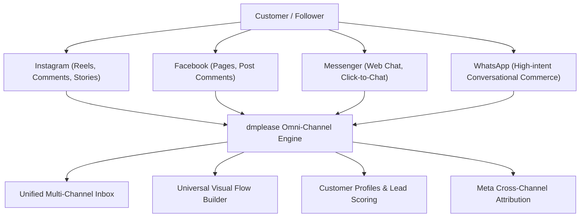
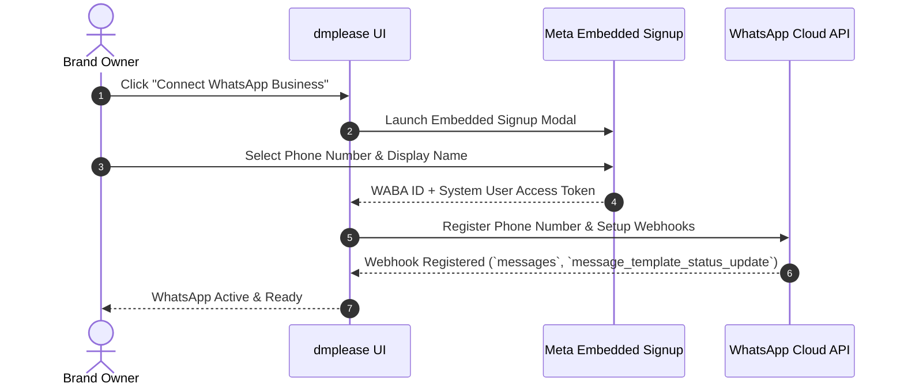
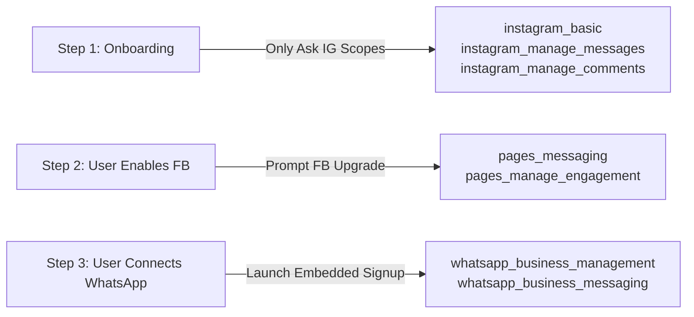

# dmplease Omni-Channel Expansion Vision & Implementation Roadmap

> **Long-Term Strategic & Architectural Blueprint:** Evolving *dmplease* from an Instagram Comment-to-DM tool into the premier **Meta Conversational Commerce & Automation Operating System** across Instagram, Facebook, Messenger, and WhatsApp Business.

---

## 1. Executive Vision & Core Philosophy

Today, **dmplease** excels at high-converting Instagram comment-to-DM automations. However, modern creators, DTC brands, and SMBs manage fragmented customer touchpoints across the entire Meta family of apps:



### The Strategic North Star
Transform dmplease into the **unified conversational operating system** that captures top-of-funnel social engagement (Instagram & Facebook) and seamlessly routes it into deep-funnel, high-converting messaging relationships (Instagram DMs, Messenger, and WhatsApp Business).

---

## 2. Multi-Horizon Implementation Roadmap

```
Horizon 1 (Months 1–2) : Instagram Polish & Dual-Authentication (Zorcha Parity)
Horizon 2 (Months 3–4) : Facebook Pages & Messenger Automation Engine
Horizon 3 (Months 5–6) : WhatsApp Business Cloud API Integration (High-LTV Commerce)
Horizon 4 (Months 7–9) : Unified Omnichannel Inbox, AI Agent, & Meta Tech Provider
```

---

### Horizon 1: Instagram Domination & Dual-Authentication
*Objective: Eliminate onboarding drop-off and maximize organic Instagram conversion before branching out.*

#### 1. Dual-Path Authentication (Matching Zorcha's Two-Button UI)
Implement two parallel connection options in `/dashboard/settings`:
1. **"Authenticate with Instagram"** (Primary):
   - Uses **Instagram Login for Professionals** (`https://api.instagram.com/oauth/authorize`).
   - Permissions: `instagram_business_basic`, `instagram_business_manage_messages`, `instagram_business_manage_comments`.
   - **Zero Facebook Page required.** Increases creator connection rates from ~60% to 90%+.
2. **"Authenticate with Meta Business"** (Secondary / Agencies):
   - Uses **Facebook Login for Business** (`https://www.facebook.com/dialog/oauth`).
   - Handles multi-account agency portfolios and users who manage IG via Facebook Pages.

#### 2. Advanced Instagram Triggers
- **Story Mention Auto-DMs:** When followers tag the creator in an Instagram Story, auto-reply with a thank-you discount code.
- **Instagram Live Comment-to-DM:** Real-time keyword listening on live streams.
- **Post-Level Performance Analytics:** Integrate `instagram_manage_insights` to compute real conversion rates (e.g. `DMs Sent / Reel Impressions`).

---

### Horizon 2: Facebook Pages & Messenger Automation
*Objective: Capture Facebook organic engagement and Click-to-Messenger ad traffic.*

#### 1. Facebook Page Post Comment-to-Messenger
- **Trigger:** A follower comments on a Facebook Page post (organic or sponsored).
- **Action:** Deliver an automated private message into Facebook Messenger (`POST /{page-id}/messages` with `recipient: { comment_id }`).
- **Required Permissions:** `pages_messaging`, `pages_manage_engagement`, `pages_read_engagement`.

#### 2. Click-to-Messenger Ad Triggers (`ads_management`)
- Sync with Facebook Ads Manager.
- When a user clicks a sponsored post with a "Send Message" CTA, dmplease immediately fires a customized conversational onboarding flow.

#### 3. Messenger Interactive UI Components
- Persistent Menu (e.g., "Browse Catalog", "Track Order", "Talk to Human").
- Horizontal product carousel cards with image, price, and direct checkout buttons.

---

### Horizon 3: WhatsApp Business Cloud API (The Revenue Engine)
*Objective: Unlock the world's highest-open-rate messaging channel (98% open rate) for order confirmations, abandoned cart recovery, and VIP sales.*

#### 1. Integration Model: Meta WhatsApp Cloud API via Embedded Signup
Avoid third-party aggregators (like Twilio or MessageBird) and connect directly to **Meta WhatsApp Cloud API**:
- **Onboarding UX:** Use **Meta Embedded Signup** (`FB.login` with `whatsapp_business_management` and `whatsapp_business_messaging`).
- The customer completes WhatsApp Business onboarding inside a dmplease popup within 60 seconds without leaving your dashboard.



#### 2. WhatsApp Message Categorization & Compliance
- **Service Conversations (Customer-Initiated):**
  - Follower messages the business &rarr; Opens a **free 24-hour service window**.
  - Any text, image, interactive list, or quick-reply button can be sent with zero template approval.
- **Template Messages (Business-Initiated):**
  - Requires pre-approved **Meta Message Templates (HSM)**.
  - Categories: **Marketing** (promotions, offers), **Utility** (order receipts, access links), **Authentication** (OTPs).
  - Built-in template manager in dmplease to design, validate, and submit templates to Meta with one click.

#### 3. Cross-Channel Bridges (Instagram &rarr; WhatsApp Funnel)
- **Instagram DM &rarr; WhatsApp Hand-off:**
  - When an Instagram follower comments `VIP`, send an Instagram DM with a Click-to-WhatsApp link containing a pre-filled ref parameter: `https://wa.me/<phone>?text=CLAIM_VIP_<USER_ID>`.
  - Capture their verified phone number on WhatsApp for lifelong high-retention marketing.

---

### Horizon 4: Unified Omnichannel Inbox, AI Agent, & Meta Tech Provider
*Objective: Institutionalize dmplease as an enterprise-grade platform with official Meta accreditation.*

#### 1. Unified Omnichannel Inbox
A single collaborative dashboard where team members see all conversations regardless of origin:
- Badges indicating source: `[Instagram DM]`, `[Facebook Messenger]`, `[WhatsApp Business]`.
- Shared customer contact card showing order history, email, phone number, and previous touchpoints across all channels.
- Human handover toggle: Pauses automation when a support agent jumps in.

#### 2. Semantic AI Agent (Powered by Gemini)
- Replace static keyword matching (`GUIDE`, `VIP`) with intelligent intent recognition:
  - If a user comments *"Where can I buy this dress?"* or *"Is the blue one in stock?"*, the AI understands the intent and delivers the exact product link via DM.
  - Automated conversational objection handling inside DMs with fallback to human staff.

#### 3. Meta Tech Provider Certification (Like Zorcha)
- Apply for **Meta Tech Provider / Business Partner Status**:
  - Unlocks higher messaging rate limits (Tier 3 WhatsApp: 100k daily conversations &rarr; Unlimited).
  - Displays the trusted *"Meta Tech Provider Certified"* badge on marketing landing pages.
  - Grants direct access to Meta Partner Engineering support.

---

## 3. Database Schema Evolution (Prisma & Supabase)

To scale cleanly from Instagram-only to omnichannel, evolve the data model to support polymorphic channels and unified customer identities:

```prisma
// 1. Channel Identity (Instagram, Facebook Page, or WhatsApp)
enum ChannelType {
  INSTAGRAM
  FACEBOOK_PAGE
  WHATSAPP_BUSINESS
}

model Channel {
  id                   String        @id @default(uuid())
  workspaceId          String
  type                 ChannelType
  externalId           String        // IG Account ID, FB Page ID, or WhatsApp Phone Number ID
  name                 String        // Display Name / Handle
  username             String?       // @handle
  avatarUrl            String?
  encryptedAccessToken String        // AES-256-GCM Vault Encrypted
  tokenExpiresAt       DateTime?
  wabaId               String?       // WhatsApp Business Account ID (for WhatsApp)
  isActive             Boolean       @default(true)
  metadata             Json?         // Webhook configs, quality tier, etc.
  createdAt            DateTime      @default(now())
  updatedAt            DateTime      @updatedAt

  workspace            Workspace     @relation(fields: [workspaceId], references: [id], onDelete: Cascade)
  conversations        Conversation[]
  campaigns            Campaign[]

  @@unique([type, externalId])
}

// 2. Unified Customer Profile (Cross-Channel Contact)
model Contact {
  id            String         @id @default(uuid())
  workspaceId   String
  name          String?
  email         String?
  phoneNumber   String?        // Global E.164 phone number
  instagramId   String?        // IGSID
  facebookId    String?        // PSID
  whatsappId    String?        // WhatsApp Phone ID
  tags          String[]
  metadata      Json?          // LTV, purchases, custom attributes
  createdAt     DateTime       @default(now())
  updatedAt     DateTime       @updatedAt

  workspace     Workspace      @relation(fields: [workspaceId], references: [id], onDelete: Cascade)
  conversations Conversation[]
}

// 3. Unified Thread & Message History
model Conversation {
  id            String         @id @default(uuid())
  channelId     String
  contactId     String
  status        String         @default("open") // open, snoozed, closed
  lastMessageAt DateTime       @default(now())
  isBotActive   Boolean        @default(true)   // Pause bot on human intervention

  channel       Channel        @relation(fields: [channelId], references: [id], onDelete: Cascade)
  contact       Contact        @relation(fields: [contactId], references: [id], onDelete: Cascade)
  messages      Message[]
}

model Message {
  id             String        @id @default(uuid())
  conversationId String
  senderType     String        // "contact", "bot", "agent"
  direction      String        // "inbound", "outbound"
  contentType    String        // "text", "template", "image", "button", "interactive_list"
  content        Json          // Dynamic payload
  externalMsgId  String?       // Meta Message ID
  deliveryStatus String?       // "sent", "delivered", "read", "failed"
  createdAt      DateTime      @default(now())

  conversation   Conversation  @relation(fields: [conversationId], references: [id], onDelete: Cascade)
}
```

---

## 4. Permissions Strategy & Staging Plan

Avoid the mistake Zorcha made (requesting all permissions upfront, causing creator anxiety). Use **Dynamic Progressive Permissioning**:



1. **Phase 1 (Default):** Request **only** the 3 Instagram-specific permissions. Keep the consent screen 100% clean.
2. **Phase 2 (When User Adds Facebook):** Prompt user to enable Facebook Page features, requesting `pages_messaging` only at that moment.
3. **Phase 3 (When User Adds WhatsApp):** Launch Meta's Embedded Signup popup, requesting `whatsapp_business_messaging` in an isolated, branded WhatsApp dialog.

---

## 5. Monetization & Business Model

Moving to omnichannel allows dmplease to transition from a single-tier subscription to a high-margin enterprise model:

| Plan | Price | Target Audience | Included Capabilities |
| :--- | :--- | :--- | :--- |
| **Creator** | \$29 / mo | Solo IG Creators | 1 Instagram Account, Unlimited Comment-to-DM, Story Mention triggers. |
| **Growth** | \$79 / mo | DTC Brands & Boutiques | 3 Channels (Instagram + Facebook Page + Messenger), Visual Flow Builder, Shared Inbox. |
| **Omnichannel Pro** | \$199 / mo + usage | Scaling E-commerce | All Channels (including WhatsApp Cloud API), AI Gemini Agent, CRM Integrations (Shopify, Klaviyo). |
| **Agency / Enterprise** | \$499+ / mo | Marketing Agencies | Multi-workspace client management, Meta Business Portfolio sync, custom SLAs, white-label reports. |

> *Note on WhatsApp Pricing:* Pass through Meta's native WhatsApp conversation fees directly via Stripe with a minor 10–15% platform management markup.

---

## 6. Execution Timeline & Next Immediate Steps

```
[Month 1] ─── Implement Direct Instagram Login (Dual-Auth UX) & Story Mentions
[Month 2] ─── Build Analytics Dashboard with `instagram_manage_insights`
[Month 3] ─── Deploy Facebook Page Post & Messenger Webhook Listeners
[Month 4] ─── Roll out Visual Drag-and-Drop Conversation Builder
[Month 5] ─── Integrate Meta WhatsApp Cloud API Embedded Signup
[Month 6] ─── Launch WhatsApp Template Manager & Cross-Channel Funnels
[Month 7] ─── Ship Unified Multi-Channel Team Inbox
[Month 8] ─── Integrate Gemini-Powered Conversational AI Agent
[Month 9] ─── Apply for Official Meta Tech Provider Certification
```
