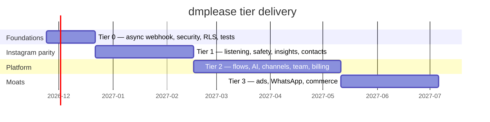

# dmplease — Product Development Tier Plan

> **Goal:** Take dmplease from a focused Instagram comment-to-DM tool to a product that matches — and on the axes that matter, beats — **Zorcha** and **LinkPlease**, without inheriting their onboarding friction or complexity.
>
> This is the single execution checklist. Companion docs: `COMPETITOR_ZORCHA_PERMISSIONS.md` (permission strategy), `ESSENTIAL_PERMISSIONS.md` (Meta scopes), `EXPANSION_VISION_ROADMAP.md` (long-term omnichannel vision), `design.md` (UI system).

---

## 0. How to read this plan

| Tier | Name | Purpose | Rule |
| :--- | :--- | :--- | :--- |
| **Tier 0** | Foundations | Correctness, security, data integrity, testability | **Blocking** — finish before any new user-facing feature |
| **Tier 1** | Instagram Parity | Everything creators actually use Zorcha/LinkPlease for | **Highest ROI** — gets ~85% of competitive value |
| **Tier 2** | Platform Breadth | Flow Builder, AI, channels, team, billing | Build after Tier 1 is stable |
| **Tier 3** | Strategic Moats | Differentiators neither competitor has | Pick selectively based on positioning |

Each item has an ID (e.g. `T0.1`), affected files, and an **Acceptance Criteria** (AC) that must be true to mark it done. Checkboxes are the source of truth — tick them as work lands.

Priority key: 🔴 blocking · 🟠 high · 🟡 medium · 🟢 optional

---

## 1. Current baseline (verified from source code)

### ✅ Working today
- Supabase auth: email/password, magic link, Google, GitHub; Supabase OAuth 2.1 consent server at `/oauth/consent`
- Meta OAuth: **Direct Instagram Login for Professionals** and **Facebook Login for Business**; AES-256-GCM token vault; long-lived token exchange + refresh endpoint
- Campaign CRUD (create/pause/delete), keyword triggers, ANY_POST / SPECIFIC_POST / NEXT_POST (stored), real IG reel picker
- DM templates with `{username}` / `{link}` / `{keyword}` variables, button CTA, rotating public replies, follow-gate, live phone preview
- Webhook: HMAC-SHA256 verification, comment→DM dispatch, 24h duplicate guard, jitter, exponential-backoff retry, plain-text fallback, DM logs
- Dashboard: log-derived activity, inbox with manual DM send, diagnostics pings

### ⚠️ Stubbed or misleading
- `inbox-automations/page.tsx` — hardcoded cards; no story-mention parser exists despite README claim
- Webhook `// TODO: Inbox keyword automation` and `// TODO: Postback flow routing`
- "Delivery Success 99.8%" and "Avg. Delivery Latency <280ms" — hardcoded
- `NEXT_POST` accepted but never honored; `fallbackReplyEnabled/Message` never read
- `WorkspaceMember` + roles exist in schema only — no UI
- No campaign edit endpoint, no tests, `zod` installed but unused, no `vercel.json` cron schedule

---

## 2. Competitive baseline (why each tier exists)

✅ working · ⚠️ partial · ❌ absent

| Capability | dmplease | Zorcha | LinkPlease | Addressed in |
| :--- | :---: | :---: | :---: | :--- |
| Direct Instagram Login for Professionals | ✅ | ✅ | ✅ | — |
| Multi-account bulk connect (Meta Business) | ⚠️ | ✅ | ⚠️ | T1.12 |
| Comment→DM keywords (posts/reels) | ✅ | ✅ | ✅ | — |
| Rotating public comment replies | ✅ | ✅ | ✅ | — |
| Ask-to-follow with real verification | ⚠️ | ✅ | ✅ | T1.11 |
| Inbound DM keyword auto-replies | ❌ | ✅ | ✅ | T1.1 |
| Story replies / reactions | ❌ | ✅ | ✅ | T1.2 |
| Story mentions | ❌ | ✅ | ⚠️ | T1.2 |
| Share-to-DM trigger | ❌ | ❌ | ✅ | T1.9 |
| Re-run on last 7 days' comments | ❌ | ✅ | ✅ | T1.8 |
| Instagram Live automation | ❌ | ❌ | ✅ | T3.4 |
| Visual Flow Builder | ❌ | ✅ | ❌ | T2.1 |
| Templates with guided notes | ⚠️ | ✅ | ❌ | T2.2 |
| AI FAQ / intent replies / multilingual | ❌ | ✅ | ⚠️ | T2.3 |
| AI DM variants + comment moderation | ❌ | ✅ | ✅ | T1.4 / T2.3 |
| Lead capture / Contacts / exports | ❌ | ✅ | ✅ | T1.7 |
| Digital products / payments in DM | ❌ | ⚠️ "Soon" | ✅ | T3.5 |
| Click-to-DM ads + conversion events | ❌ | ✅ | ❌ | T3.1 |
| Facebook Pages + Messenger | ❌ | ✅ | ✅ | T2.4 |
| WhatsApp | ❌ | ❌ | ❌ | T3.2 |
| Meta Insights / real conversion analytics | ❌ (scope requested, unused) | ✅ | ✅ | T1.5 |
| Link-click / open tracking | ❌ | ✅ | ✅ | T1.6 |
| Shareable public analytics reports | ❌ | ✅ | ❌ | T1.10 |
| Rate caps / smart queue / viral-spike throttle | ⚠️ | ✅ | ✅ | T1.4 |
| Team members & roles | ⚠️ schema only | ⚠️ | ❌ | T2.5 |
| Public API / MCP | OAuth IdP only | ✅ MCP | ❌ | T2.8 |
| Link-in-Bio | ❌ | ✅ | ❌ (despite name) | T2.7 |
| Billing / plan limits / usage enforcement | ❌ | ✅ | ✅ | T2.6 |

---

## 3. Tier 0 — Foundations 🔴 (blocking)

**Objective:** Make the current product correct, secure and testable. Nothing else matters if Meta times out our webhook or an attacker can forge requests.

### T0.1 — True asynchronous webhook processing 🔴
- [ ] Return HTTP 200 to Meta immediately; move all DB/API work off the request path.
- [ ] Use Next.js 16 `after()` or a durable job table (`webhook_jobs`) with a worker.
- [ ] Persist raw webhook events with status `PENDING` → `PROCESSING` → `DONE`/`FAILED`.
- [ ] Add bounded retries with dead-letter queue; no silent catch-all that hides failures.
- [ ] **Files:** `app/api/webhook/route.ts`, `lib/meta/webhook.ts`, `prisma/schema.prisma`
- **AC:** A webhook POST returns 200 in < 200ms even when the DM dispatch takes 5s; a forced failure is retried and lands in the dead-letter table with the original payload.

### T0.2 — Fail-closed security 🔴
- [ ] Remove fallback dev secrets from `META_VERIFY_TOKEN` handshake and `verifyWebhookSignature`.
- [ ] Remove hardcoded fallback `TOKEN_VAULT_SECRET` and OAuth-state signing secret; require env vars in production.
- [ ] Do not accept unsigned webhooks when no app secret is configured.
- [ ] Rotate any secrets that were previously committed to `.env*`.
- [ ] **Files:** `lib/meta/webhook.ts`, `lib/meta/vault.ts`, `lib/meta/client.ts`, `app/api/webhook/route.ts`
- **AC:** With secrets unset in production, the app fails at startup/request time with a clear error; an unsigned POST returns 401.

### T0.3 — Cron authentication + scheduling 🔴
- [ ] Require `Authorization: Bearer <CRON_SECRET>` on `/api/cron/refresh-tokens`.
- [ ] Add `vercel.json` (or platform equivalent) with a daily schedule.
- [ ] Log refresh outcome per account.
- [ ] **Files:** `app/api/cron/refresh-tokens/route.ts`, new `vercel.json`
- **AC:** Unauthenticated request returns 401; scheduled run refreshes tokens expiring within 14 days and records results.

### T0.4 — Row Level Security on business tables 🔴
- [ ] Enable RLS and add SELECT/INSERT/UPDATE/DELETE policies for `automations`, `instagram_accounts`, `dm_logs` scoped to workspace membership.
- [ ] Add policies for admin/member roles (even before the UI exists) so future features inherit correct access.
- [ ] **Files:** new `supabase/migrations/<timestamp>_rls_business_tables.sql`
- **AC:** A Supabase client authenticated as user A cannot read user B's automations/accounts/logs; service-role webhook path still works.

### T0.5 — Replace fabricated metrics 🔴
- [ ] Remove hardcoded `99.8%` delivery success and `<280ms` latency strings.
- [ ] Measure real dispatch latency (timestamp at webhook receipt → Graph API response) and store it.
- [ ] Compute delivery rate from `dm_logs`; show `—` until data exists.
- [ ] Remove the fake "Edge Runtime / Fluid Compute" compute check in diagnostics.
- [ ] **Files:** `app/dashboard/page.tsx`, `app/dashboard/overview/page.tsx`, `app/dashboard/diagnostics/page.tsx`, `prisma/schema.prisma`
- **AC:** Every number on the dashboard is derived from stored data or a real measurement; no static "performance" claims remain.

### T0.6 — Honour stored configuration 🔴
- [ ] Implement `NEXT_POST` scope in webhook filtering (resolve the next published media ID at dispatch time).
- [ ] Wire or delete `fallbackReplyEnabled` / `fallbackReplyMessage`.
- [ ] Validate campaign input with `zod` on create/toggle paths.
- [ ] **Files:** `app/api/webhook/route.ts`, `app/dashboard/campaigns/actions.ts`, `prisma/schema.prisma`
- **AC:** A NEXT_POST automation only fires for the creator's most recent post; invalid campaign payloads are rejected with a field-level error.

### T0.7 — Tests and validation 🔴
- [ ] Add Vitest (unit) + Playwright (E2E smoke) with `test` scripts.
- [ ] Unit tests for all webhook parsers, keyword matching, duplicate guard, personalization, retry logic.
- [ ] E2E: sign-up → connect (mocked Meta) → create campaign → simulate comment webhook → assert DM log.
- [ ] **Files:** `package.json`, new `tests/**`, CI workflow
- **AC:** `npm test` passes locally and in CI; parser tests cover comments, messages, postbacks, read events, story payloads.

### T0.8 — Unify the data access layer 🔴
- [ ] Choose one primary write path (recommend Prisma for server/webhook, Supabase PostgREST for RLS-protected reads) and document it.
- [ ] Remove `[YOUR-PASSWORD]` string-sniffing from `hasDb`; use proper config validation.
- [ ] Remove stale starter scaffolding (`components/tutorial/**`, `env-var-warning.tsx`, `deploy-button.tsx`, legacy wrappers).
- [ ] **Files:** `lib/`, `app/api/webhook/route.ts`, `components/`
- **AC:** No feature writes the same entity through two different clients; config errors surface at startup, not mid-webhook.

---

## 4. Tier 1 — Instagram parity 🟠 (highest ROI)

**Objective:** Match the events, safety and analytics that make Zorcha and LinkPlease useful day-to-day. Both competitors' core value is "listen to more signals, send safely, measure results" — this tier delivers all three.

### T1.1 — Inbound DM keyword automation 🟠
- [ ] New tables: `contacts`, `conversations`, `messages`, `dm_rules`.
- [ ] Parse inbound DM text; match keyword rules (whole-word + case-insensitive, or "any keyword" once per 45 days).
- [ ] Keyword rules take priority over generic fallback; "Respond to all DMs" behaviour like Zorcha.
- [ ] Store full inbound/outbound history; replace the log-synthesized inbox.
- [ ] **Files:** `prisma/schema.prisma`, `app/api/webhook/route.ts`, `app/dashboard/inbox/**`, `components/inbox/**`
- **AC:** Sending "PRICE" in a DM triggers the configured reply; the thread shows both inbound and outbound messages; a second "PRICE" within 45 days does not re-trigger.

### T1.2 — Story reply + Story mention triggers 🟠
- [ ] Add parsers for story reply/reaction and story-mention payloads; subscribe to the corresponding Meta webhook fields.
- [ ] Dedupe per mention/reply; store events for re-run (T1.8).
- [ ] Replace the static `inbox-automations` cards with a real rule editor (trigger → keyword filter → message).
- [ ] Suppress duplicate automations when both a quick automation and a story flow are live, as Zorcha does.
- [ ] **Files:** `lib/meta/webhook.ts`, `app/api/webhook/route.ts`, `app/dashboard/inbox-automations/page.tsx`, new components
- **AC:** Tagging the creator in a Story produces exactly one thank-you DM; a second event for the same Story does not; the UI shows the rule as live.

### T1.3 — Postback / button routing 🟠
- [ ] Wire `parsePostbackEvents`; payload routes to tag contact, branch flow, or schedule follow-up.
- [ ] Treat a button tap as opt-in and as a refresh of Meta's 24-hour messaging window.
- [ ] **Files:** `app/api/webhook/route.ts`, `lib/meta/webhook.ts`, new `postback_routes` table
- **AC:** Tapping a tracked button updates the contact tag and enables a follow-up that would otherwise be blocked.

### T1.4 — Safety engine (core differentiator) 🟠
- [ ] Central limiter in `lib/meta/rate-limit.ts`: per-account token bucket + configurable hourly reply cap.
- [ ] Randomized delay before each send (configurable, default 0–50s like Zorcha).
- [ ] DM variant rotation — multiple message templates sent round-robin/randomly (LinkPlease's headline AI rotation, without needing AI).
- [ ] Viral-spike detection: throttle instead of blasting when comment volume surges.
- [ ] Pre-launch validation: loop/duplicate/spam-pattern screening.
- [ ] Reply-once-per-person-per-post (30-day memory) and skip comment-thread replies.
- [ ] Show queue depth / sends-per-hour / limit breaches in diagnostics.
- [ ] **Files:** `lib/meta/rate-limit.ts`, `app/api/webhook/route.ts`, `app/dashboard/diagnostics/page.tsx`, `prisma/schema.prisma`
- **AC:** With a cap of 100/hour, the 101st message is queued, not sent; a spike of 500 comments drains over time with no 429s; diagnostics shows real numbers.

### T1.5 — Meta Insights integration 🟠
- [ ] Call `GET /{ig-id}/insights` and `/{media-id}/insights` using the already-requested `instagram_manage_insights` scope.
- [ ] Persist daily snapshots: reach, impressions, profile views, story views.
- [ ] Compute **conversion rate = automated DMs ÷ impressions** per post/campaign.
- [ ] Handle missing Advanced Access gracefully with a clear "request access" state.
- [ ] **Files:** new `lib/meta/insights.ts`, new `insight_snapshots` table, `app/api/cron/**`, `app/dashboard/overview/page.tsx`
- **AC:** A connected account shows reach/impressions for the last 30 days and a real conversion-rate figure; no call is made without the scope.

### T1.6 — Link click + open tracking 🟠
- [ ] Add `/go/[slug]` redirect endpoint that records click events (contact, campaign, timestamp, referrer).
- [ ] Rewrite campaign button URLs to tracked links.
- [ ] Record delivery/read status where Meta provides it.
- [ ] **Files:** new `app/go/[slug]/route.ts`, `app/dashboard/campaigns/actions.ts`, `prisma/schema.prisma`
- **AC:** Clicking a DM button increments a counter visible on the campaign and analytics pages.

### T1.7 — Lead capture / Contacts 🟠
- [ ] "Collect Info" step for quick automations: email, phone, name, custom property, validation + retry message + skip.
- [ ] Contact records linked to conversations, with tags, custom properties, source attribution and CSV export.
- [ ] **Files:** `prisma/schema.prisma`, `app/dashboard/contacts/**` (new), `app/api/contacts/**` (new)
- **AC:** A DM collecting an email creates/updates a contact, shows it in the contacts table, and exports to CSV.

### T1.8 — Re-run / retro-trigger 🟠
- [ ] Persist incoming comment/message events (needed because Meta does not replay them).
- [ ] UI: "Re-run on comments from last 7 days" for an automation, with dry-run preview and duplicate suppression.
- [ ] **Files:** `prisma/schema.prisma`, new `app/api/campaigns/rerun/route.ts`, campaign UI
- **AC:** A new automation can be applied to the previous 7 days' comments; already-contacted users are skipped; dry-run shows the recipient count.

### T1.9 — Share-to-DM trigger 🟠
- [ ] Parse `message.attachments.share` / share payloads and trigger an automation.
- [ ] Surface as a campaign trigger option alongside comments/DMs/stories.
- [ ] **Files:** `lib/meta/webhook.ts`, `app/api/webhook/route.ts`, campaign builder
- **AC:** Sharing a Reel to the creator's DM delivers the configured thank-you DM once.

### T1.10 — Analytics rewrite 🟠
- [ ] Replace log-only metrics with: DMs sent, delivery rate, opt-ins, link clicks, conversion vs reach, keyword distribution, trend over time.
- [ ] Per-campaign and per-account breakdowns; 7/30/90-day comparisons.
- [ ] Shareable public report links (Zorcha feature) with an opt-in toggle and revocable token.
- [ ] **Files:** `app/dashboard/overview/page.tsx`, new `app/api/reports/**`, new components
- **AC:** Every displayed figure is query-backed; a generated public link renders a read-only report and can be revoked.

### T1.11 — Ask-to-follow with real verification 🟠
- [ ] Add an "opening message" opt-in tap before releasing the promised link.
- [ ] Verify follow status once per user lifetime; hold the link until verified.
- [ ] Skip the tap for users who messaged within 24 hours.
- [ ] **Files:** `lib/meta/client.ts` (`checkIsFollower` already exists), `app/api/webhook/route.ts`, campaign builder
- **AC:** A non-follower who comments receives the tap card; only after following do they get the link; a follower gets it immediately.

### T1.12 — Multi-account bulk connect 🟠
- [ ] After Meta Business OAuth, show an account-selection checklist with live "Create N workspaces" count.
- [ ] Support search over long Page/IG lists; grey out already-connected accounts; retry failed ones.
- [ ] **Files:** `app/api/auth/meta/callback/route.ts`, `components/onboarding/onboarding-wizard.tsx`, `app/dashboard/settings/page.tsx`
- **AC:** Connecting 5 accounts in one OAuth flow creates 5 isolated workspaces; duplicates are not created.

---

## 5. Tier 2 — Platform breadth 🟡

**Objective:** Become a "platform", not a single-trigger tool. These are larger builds; start only when Tier 0/1 are stable and tested.

### T2.1 — Visual Flow Builder 🟡
- [ ] Flow definition schema (versioned JSON): nodes, edges, trigger config, step config.
- [ ] Canvas UI (React Flow or similar) with node palette, validation and save/publish/version.
- [ ] Triggers (phase 1): comment, DM, story reply, story mention, postback, contact created/tag added.
- [ ] Steps (phase 1): text, image, card with button, delay, condition (Yes/No), randomize A/B, collect info, add tag.
- [ ] Steps (phase 2): audio, file/PDF delivery, media, card carousel, HTTP request, Google Sheets, Meta conversion event.
- [ ] Server-side interpreter with per-step logging and the T1.4 safety engine applied to every send.
- [ ] **Files:** new `prisma` flow models, `app/dashboard/flows/**`, `components/flows/**`, `lib/flows/**`
- **AC:** A flow with 2 triggers, a condition and a delay can be validated, published, executed and inspected step-by-step in logs.

### T2.2 — Template library 🟡
- [ ] Goal-filtered templates (followers / clicks / leads) with per-step notes.
- [ ] "Requires upgrade / requires integration" gating that opens the correct upgrade or connection prompt.
- [ ] Quick automation path remains the default for new users — never force the Flow Builder.
- [ ] **Files:** new `lib/templates/**`, `app/dashboard/flows/templates/**`
- **AC:** A new user can launch a working automation from a template in under 2 minutes.

### T2.3 — AI FAQ, variants and moderation 🟡
- [ ] Intent-based FAQ replies in the language the user writes; persona/tone/length/emoji controls.
- [ ] Learn from past replies; auto-draft new FAQs from repeated questions; fallback message; built-in tester.
- [ ] AI DM variant generator (feeds T1.4 rotation).
- [ ] Comment Guard: hide/delete spam, hate, scams, competitor promos with sensitivity control and review log.
- [ ] Credit-based usage metering with top-ups.
- [ ] **Files:** new `lib/ai/**`, `app/dashboard/ai/**`, new `ai_credits` models
- **AC:** An FAQ answer is generated for a paraphrased question in another language; a test panel shows the answer before publishing; moderation actions are reviewable.

### T2.4 — Facebook Pages + Messenger 🟡
- [ ] Add `pages_messaging` / `pages_manage_engagement` behind an explicit opt-in upgrade (never in default scopes).
- [ ] Page post comment→Messenger and inbound Messenger message handling.
- [ ] Handle Meta's default Messenger routing app requirement with a setup check.
- [ ] One workspace per connected Page, isolated like Instagram workspaces.
- [ ] **Files:** `lib/meta/client.ts`, `lib/meta/webhook.ts`, `app/api/webhook/route.ts`, onboarding, settings
- **AC:** A Page comment triggers a Messenger reply, and the setup check warns when another app controls the conversation.

### T2.5 — Team management and roles 🟡
- [ ] Invite/remove members by email; assign OWNER / ADMIN / MEMBER.
- [ ] Enforce roles server-side in all Server Actions and API routes (not just UI).
- [ ] Audit log of membership and permission changes.
- [ ] **Files:** new `app/dashboard/team/**`, `app/api/team/**`, `lib/workspace-context.tsx`
- **AC:** A MEMBER cannot delete a campaign or see billing; an ADMIN can; all changes are audited.

### T2.6 — Billing, plans and usage enforcement 🟡
- [ ] Stripe (or equivalent) checkout, webhooks, subscription state.
- [ ] Plan limits: accounts, monthly DMs, contacts, AI credits, feature gates.
- [ ] Usage metering that pauses automations when limits are hit, with clear UI and upgrade path.
- [ ] **Files:** new `lib/billing/**`, `app/api/billing/**`, `app/dashboard/billing/**`, pricing page
- **AC:** A free account hitting its DM cap stops sending, shows a banner, and upgrading restores sending without data loss.

### T2.7 — Link-in-Bio 🟡
- [ ] Free templates, unlimited links, social links, buttons, media gallery, embeds, SEO.
- [ ] Pro: dynamic QR codes, password lock, Instagram grid, basic analytics.
- [ ] Public page rendering at `/bio/[handle]` with custom domain ready.
- [ ] **Files:** new `app/bio/**`, `prisma` bio models
- **AC:** A creator publishes a bio page with 10 links and sees click analytics; Zorcha parity achieved, LinkPlease does not offer this.

### T2.8 — Automation API + MCP server 🟡
- [ ] Public API with scoped API keys (leverage the existing OAuth 2.1 server at `/oauth/consent`).
- [ ] MCP server exposing: list/switch workspaces, list/search/inspect automations, create/edit/duplicate, set messages/keywords/buttons/links, start/stop/draft.
- [ ] Explicitly exclude billing, contact writes and destructive deletes from MCP.
- [ ] **Files:** new `app/api/v1/**`, new `app/mcp/**`, OAuth scope definitions
- **AC:** An MCP client can create and publish an automation end-to-end; it cannot access billing or delete workspaces.

---

## 6. Tier 3 — Strategic moats & optional expansions 🟢

Pick based on positioning; these are not required for parity.

### T3.1 — Click-to-DM ads + Meta conversion events 🟢
- [ ] Ad-account/ad picker, comment-on-ad and ad-DM triggers, conversion event step in flows.
- [ ] Request `ads_management` **only** behind an explicit agency/ads upgrade — never in the default OAuth screen.
- [ ] **Caution:** high App Review and consent-friction cost. See `COMPETITOR_ZORCHA_PERMISSIONS.md`.

### T3.2 — WhatsApp Business Cloud API 🟢
- [ ] Embedded Signup with `whatsapp_business_management` / `whatsapp_business_messaging`.
- [ ] Service vs template message handling, template manager, quality-tier tracking.
- [ ] Instagram DM → WhatsApp hand-off link with referral parameters.
- [ ] **Why:** **neither** Zorcha nor LinkPlease has native WhatsApp automation — this is a true moat, already outlined in `EXPANSION_VISION_ROADMAP.md` (Horizon 3).

### T3.3 — Meta Tech Provider status 🟢
- [ ] Complete business verification, Advanced Access for core scopes, partner badge.
- [ ] Higher rate limits and direct partner engineering support.

### T3.4 — Instagram Live automation 🟢
- [ ] Real-time keyword listening on Live comments → DM. LinkPlease has this; cheap after T1.1.

### T3.5 — Digital products / payments in DM 🟢
- [ ] Product/course records, checkout, file delivery in DM, order history, refunds, UTM revenue analytics.
- [ ] Zorcha marks this "Soon"; LinkPlease ships it — largest scope, defer unless commerce is the strategy.

### T3.6 — Collabs / Refer & Earn 🟢
- [ ] Creator profile for brand collaborations; referral link and commission tiers. Zorcha has both.

---

## 7. Execution sequence

| Sprint | Focus | Tiers |
| :--- | :--- | :--- |
| 1 | Foundations — webhook, security, RLS, cron, metrics, tests | T0.1–T0.8 |
| 2 | Listening — conversations, DM rules, stories, postbacks | T1.1–T1.3 |
| 3 | Safety + data — limiter, variants, insights, clicks, contacts, re-run | T1.4–T1.8 |
| 4 | Analytics UX — real reports, follow opt-in, bulk connect, share trigger | T1.9–T1.12 |
| 5 | Platform — minimal Flow Builder, templates, AI FAQ, FB/Messenger, team | T2.1–T2.5 |
| 6 | Business & moats — billing, Link-in-Bio, MCP, then selected T3 items | T2.6–T2.8, T3 |

**Sprints 1–4 alone deliver ~85% of the value creators use Zorcha/LinkPlease for.**

---

## 8. Definition of done — product-level success metrics

| Metric | Baseline | Target after Tier 1 | Target after Tier 2 |
| :--- | :--- | :--- | :--- |
| Webhook response time | full processing inline | < 200ms, async | < 200ms, async |
| Trigger types supported | comments only | comments, DMs, stories, mentions, shares, postbacks | + flows, ads, Messenger |
| Analytics data source | local logs + hardcoded | logs + Meta Insights + clicks | + AI, products, cross-channel |
| Rate-limit safety | jitter + retry | caps, queue, variants, spike control | + global budget dashboard |
| Contact records | none | full contacts + exports | + segments, broadcasts, CRM-ish |
| Test coverage | none | parsers + E2E critical path | + flow engine + billing |
| Setup time for first automation | ~2 min | < 2 min (unchanged) | < 2 min via template, flows optional |
| Meta scopes requested by default | 8 FB / 3 IG | unchanged | unchanged — extras gated |

---

## 9. Explicit non-goals (do not copy the competition's mistakes)

- ❌ **Do not add `ads_management` or `business_management` to default OAuth.** Zorcha's consent screen asks users to "manage ads" and "manage your business", which creates creator anxiety and App Review friction. Gate these behind explicit upgrades (T3.1).
- ❌ **Do not force a Flow Builder on new users.** Zorcha's 26-step setup is a weakness. Keep "pick keyword → write message → go live" as the default fast path (T2.2).
- ❌ **Do not chase LinkPlease's "link-in-bio".** It is a legacy name artifact — independent comparisons confirm they do not ship a bio-page builder. We would actually be ahead (T2.7).
- ❌ **Do not build Flow Builder before T0.1.** A flow engine on a timeout-prone webhook amplifies failures.
- ❌ **Do not trust hardcoded/fake metrics.** Every number must be query- or measurement-backed (T0.5).
- ❌ **Do not ship new features without RLS and role enforcement** (T0.4, T2.5).

---

## 10. Research notes & sources

- The product is **Zorcha** (with "r") at `zorcha.com`; "Zocha" is a misspelling. Zorcha's exact Meta scope strings were **not verifiable** from public docs ("select all permissions"), so the permission comparison in `COMPETITOR_ZORCHA_PERMISSIONS.md` remains an internal estimate.
- Two LinkPlease sites exist: `linkplease.co` (official, used here) and `linkplease.co.in` (different product shape — Hindi/Hinglish AI, UPI checkout, story mentions). Relationship unconfirmed; "⚠️" entries above come from the latter only.
- Competitor scale claims (Zorcha 60K+ users / 100M messages monthly; LinkPlease 45K+ users / 150M DMs) are self-reported marketing figures.
- Primary sources:
  - `https://zorcha.com/`, `https://zorcha.com/pricing/`, `https://zorcha.com/products/free-unlimited/`, `https://zorcha.com/products/ai-faq/`, `https://zorcha.com/products/mcp/`, `https://zorcha.com/blogs/what-is-zorcha-custom-flow-builder/`
  - `https://help.zorcha.com/en/articles/18295781-how-zorcha-helps-keep-your-instagram-account-safe`, `.../18451276-start-a-flow-builder-automation-when-someone-mentions-you-in-a-story`, `.../13924056-setting-up-comment-to-dm`
  - `https://linkplease.co/`, `https://linkplease.co/pricing`, `https://linkplease.help.center/article/1011-how-to-create-comment-automation`
  - `https://www.blotato.com/blog/linkplease-vs-manychat`, `https://www.hypello.com/linkplease-compare`

---

**Maintenance rule:** Tick a checkbox only when its Acceptance Criteria is demonstrably true. When a tier is complete, add a dated "Completed" note under its heading and link to the PR/release that shipped it.

---

## 11. Tier 0 implementation status — 2026-11-25

### Shipped in code
- ✅ **T0.1** Webhook now verifies HMAC synchronously, records a job, and returns 200 immediately. All processing runs via Next.js `after()` in `lib/meta/webhook-processor.ts`; failures are recorded on the job instead of being swallowed. `maxDuration = 60`.
- ✅ **T0.2** Fail-closed secrets: `lib/config.ts` centralises all secret reads; no hardcoded production fallbacks. Vault decrypts legacy keys for compatibility but always encrypts with the current key. OAuth state accepts legacy signatures for in-flight flows only.
- ✅ **T0.3** `/api/cron/refresh-tokens` requires `Authorization: Bearer CRON_SECRET`; `vercel.json` schedules it daily at 03:00 UTC. Refresh results log account IDs, never tokens.
- ✅ **T0.5** All fabricated dashboard metrics removed. Delivery rate, unique leads, and processing time are now computed from `dm_logs` and the webhook ledger. Landing-page copy no longer claims sub-280ms/99.8% as fact; sample dashboard data is labelled as such.
- ✅ **T0.6** `NEXT_POST` now resolves the latest published media before matching; campaign creation validates input with zod and surfaces field-level errors in the builder. Follow-gate is now a real, visible toggle in the campaign builder.
- ✅ **T0.7** Vitest suite added: 25 passing tests across config, signature verification, webhook parsers, retry/personalisation/post-scope logic, and campaign validation (`npm test`). Lint is scoped to source files (`npm run lint` → clean). `npx tsc --noEmit` → clean.
- ✅ **T0.8** All `[YOUR-PASSWORD]` string-sniffing replaced by `hasDatabaseUrl()` in `lib/config.ts`; the stale `/protected` redirect was removed.

### Manual steps still required by the operator
- ✅ **T0.1 / T0.4 — `supabase/migrations/20261125_tier0_hardening.sql` is applied and verified.** Via Supabase MCP: `webhook_events` exists with the expected columns, and `automations`, `instagram_accounts`, `dm_logs`, and `webhook_events` all have RLS enabled. Workspace-member policies are in place. (Older permissive policies also remain; they can be removed later.)
- ⚠️ **T0.3 — set `CRON_SECRET` in Vercel** to the same value used locally. It was generated in `.env` / `.env.local` for local development.
- ⚠️ **Run `npx prisma generate` once the dev server is stopped** so the generated client includes the `WebhookEvent` model. The runtime code uses parameterised raw SQL, so it does not depend on this step.
- ⚠️ **T0.7 — Playwright E2E smoke test** is not yet added; unit coverage is in place.

### UI/UX improvements made in Tier 0
- Diagnostics is now an honest, scannable health report: each check has a real measurement, a plain-language description, an actionable "Fix:" hint, and an `aria-live` summary banner. The fake compute-benchmark and fake rate-limit text were removed.
- Global keyboard focus rings and `prefers-reduced-motion` support added in `app/globals.css`.
- Role/`aria-hidden` attributes added to decorative icons and error banners; campaign publish errors now show per-field guidance.
- The phone simulator now shows the selected post's caption, and the previously inert follow-gate setting is exposed as a real control.

### Verification log — second pass (2026-11-25)
- `npm run lint` → clean. `npx tsc --noEmit` → clean. `npm test` → 25/25 passing. `npm run build` → success (40 static/PPR pages, all API routes compiled).
- Supabase MCP: project URL matches env; `webhook_events` columns verified; RLS enabled on `automations`, `instagram_accounts`, `dm_logs`, `webhook_events`; `is_workspace_member()` verified as `SECURITY DEFINER`.
- Live API: signed webhook → 200 (warm 23–47 ms), unsigned → 401, handshake → 200 + challenge; cron without auth → 401, with token → 200.
- Browser: all nine dashboard screens rendered with zero console errors. Lighthouse on auth screens: **Accessibility 1.0, Best Practices 1.0, SEO 1.0**.
- Fixes made during verification: `<main>` landmark on all auth pages; `robots.txt` route plus public-path allowlist in the auth proxy; `searchParams` moved inside Suspense on the analytics page; inbox empty state instead of a blank page; diagnostics summary now counts "Not configured" as needing attention.
- Not exercised locally: real Instagram DM delivery (no connected account / no localhost OAuth redirect) and durable webhook-job writes (`DATABASE_URL` still a placeholder in `.env`/`.env.local`). Both code paths are implemented and compile; they need real credentials to run.

---

## 12. Tier 1 implementation status — 2026-11-25

### Database (applied via Supabase MCP)
- `20261125_tier1_core.sql` → `contacts`, `conversations`, `messages`, `dm_rules`, `comment_events`, `pending_dms`, `link_clicks`, `safety_events` + new `automations` columns (`dm_variants`, `collect_field`, `opening_message`, `hourly_cap`), indexes and workspace-scoped RLS.
- `20261125_tier1_insights.sql` → `insight_snapshots` with RLS.
- Prisma schema mirrored; client regenerated successfully.

### Shipped
- ✅ **T1.1** Real inbound-DM keyword rules with whole-word matching, priority, once-per-N-days, contact + conversation + message history, and a real inbox instead of log-synthesised threads.
- ✅ **T1.2** Story mention/reply parsers, dedupe via message external IDs, and a real rule editor replacing the fake cards. Story rules are suppressed to the highest-priority live rule.
- ✅ **T1.3** Postback routing: `OPTIN:` (follow verification + DM release), `TAG:` (contact tag), with the 24-hour messaging window treated as open.
- ✅ **T1.4** Safety engine: per-account token-bucket limiter with hourly caps and queued overflow, randomised delays, DM variant rotation, viral-spike throttling, pre-launch validation, 24h duplicate guard, and live safety counts in diagnostics.
- ✅ **T1.5** Meta Insights fetcher + daily cron + manual refresh, snapshots stored in `insight_snapshots`, conversion rate shown on analytics with honest empty state.
- ✅ **T1.6** Signed `/go/[slug]` tracked links with click ledger; redirects are public (fixed an auth-proxy bug that sent followers to login).
- ✅ **T1.7** Lead capture via `collect_field` + reply parsing/validation, contacts page with search and CSV export.
- ✅ **T1.8** Comment events persisted for retro re-runs; dry-run count + confirmation UI + `after()` background dispatch.
- ✅ **T1.9** Share-to-DM parser and rule trigger.
- ✅ **T1.10** Analytics extended with Insights, conversion rate and refresh control.
- ✅ **T1.11** Ask-to-follow: opening message with opt-in button, one-time follow verification, then DM release.
- ✅ **T1.12** Bulk multi-account connection: `/api/instagram/accounts` lists accounts available to the stored Meta token with connected flags; `/api/instagram/accounts/connect` creates one isolated workspace per selected account; Settings shows a searchable checklist with live "Create N workspaces".

### Verification
- `npm run lint`, `npx tsc --noEmit`, `npm test` (34/34), `npm run build` — all clean.
- Browser: all Tier 1 screens render with zero console errors; rule create → list → delete verified end-to-end against Supabase; tracked link verified to return 302 to the destination.
- Signed webhook with mixed comment/story/DM/postback/share payload → 200 in ~200 ms; no unhandled errors.

### Caveats
- Live DM delivery and durable job writes still require a real `DATABASE_URL` and a connected Instagram account (localhost is not an approved OAuth redirect).
- The limiter is per-process; the `safety_events` table is the cross-instance audit trail, not a global distributed cap.
- All twelve Tier 1 items are implemented. Bulk connect requires a first connected account (it reuses that token for `/me/accounts`); localhost is not an approved OAuth redirect, so the full Meta-Business multi-select path could not be exercised locally.

---

## 13. First-time creator UX pass — 2026-11-25

- **Guided setup on the Dashboard:** a dismissible "Get started" checklist with four real-state steps (connect account → create campaign → add auto-reply rule → send a test DM), progress bar, and a direct action on each step. It hides itself once all four are complete.
- **Plain-language navigation:** sidebar and breadcrumbs now read Analytics, Inbox, Contacts, Campaigns, Auto-replies, Activity Log, Settings, System Health — no internal "DM Execution Logs" / "Inbox Automations" jargon.
- **Onboarding honesty and clarity:** Instagram is marked Recommended; the second path is accurately labelled "Meta Business" (Messenger is a Tier 2 item); fake claims ("140ms", "100% Policy Safe") removed; attribution is optional with a Skip button; the final screen explains how to test the first campaign.
- **Campaign builder:** added a plain-language "New here?" helper and a success banner on the campaigns list after publishing (`?created=1`).
- **Accessibility:** added aria-labels to the sidebar toggle, mobile nav, theme switcher and sign-out buttons; fixed low-contrast muted labels in dark mode. Dashboard Lighthouse is back to **Accessibility 1.0 / Best Practices 1.0 / SEO 1.0** with zero console errors.
- All automated checks remain green: lint, typecheck, 34 tests, production build.
