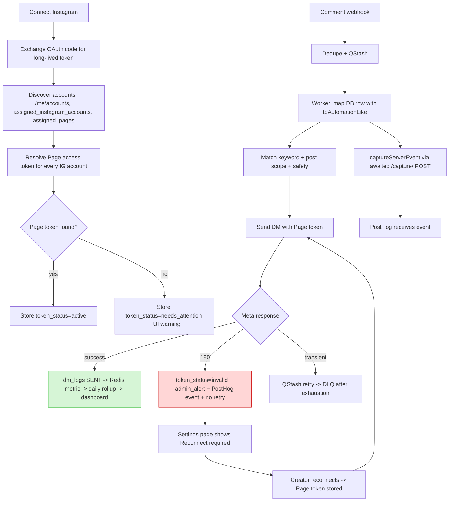

# Production Flow, Incident Diagnosis & Reliability Fix

> **Incident:** 2026-11-26 — campaign launched, Instagram comment posted, but no DM, no analytics and no usable product events.
> **Status:** Root causes identified; production fixes deployed; one creator action still required (reconnect with a Page token).
> **Last updated:** 2026-11-26

---

## 1. Executive summary

The system is **receiving comments correctly**. It failed in two separate places:

1. **Automation field mapping bug** — the live webhook path cast snake_case database rows to a camelCase TypeScript interface, so every automation field was `undefined` at runtime. Fixed in `f6ff86d`.
2. **Wrong Graph API host (the real DM blocker)** — DMs, public replies and webhook subscriptions used `graph.instagram.com`, which only accepts Instagram Basic Display (`IG...`) tokens. This account uses a Facebook-linked **system-user** token (`EAA...`), which is valid and has `instagram_manage_messages`, but `graph.instagram.com` rejects it with `OAuthException 190: Invalid OAuth access token - Cannot parse access token`. Sending the same token to `graph.facebook.com` works. Fixed by selecting the host from the token prefix.
3. **Corrupt `META_APP_ID` in Vercel Production** — the stored value had a leading `U+FFFD`, so `debug_token` failed with "Invalid application ID". Rewritten from the clean local value; app token now validates.
4. **PostHog server events were sometimes lost** at invocation shutdown (`still queued when shutdown ended`). Fixed by direct awaited `capture/` POSTs.

Analytics stayed empty correctly: `dm_sent` is only counted after a successful DM, and none succeeded.

---

## 2. Detailed production flow (observed)

```mermaid
flowchart TD
    A[Creator launches campaign in dashboard] --> A1[POST /api/campaigns or Supabase write]
    A1 --> A2[campaign_published event sent to PostHog]
    A2 --> A3[automations row: keyword LINK, SPECIFIC_POST, follow gate ON]

    B[Follower comments LINK on reel in Instagram app] --> C[Meta webhook POST /api/webhook]
    C --> C1{X-Hub-Signature-256 valid?}
    C1 -- no --> CX[Drop 401]
    C1 -- yes --> C2[Redis dedupe claim by comment id]
    C2 --> C3[recordWebhookReceived -> webhook_events row]
    C3 --> C4[QStash publishJSON -> worker]

    C4 --> D[POST /api/workers/qstash, QStash signature verified]
    D --> E[processWebhookPayload]

    E --> E1[parseCommentEvents]
    E1 --> E2[getAccount by Instagram account id]
    E2 --> E3[persistCommentEvent -> comment_events row]
    E3 --> E4{active automations for workspace?}

    E4 -- no --> SK[skipped: No active automation]
    E4 -- yes --> F[for each automation]

    F --> F1[findMatchingKeyword]
    F1 --> F2[matchesPostScope]
    F2 --> F3[24h duplicate / cooldown / safety cap]
    F3 --> F4{follow gate enabled?}
    F4 -- yes --> F5[createPending + sendPrivateReplyWithButton]
    F5 --> F6{opted in?}
    F6 -- no --> SK2[skipped: waiting for opt-in — no dm_sent metric]
    F6 -- yes --> G[sendCommentDm]
    F4 -- no --> G

    G --> H[Meta POST /{ig-id}/messages with Bearer token]
    H --> I{Meta response}
    I -- success --> J[dm_logs status=SENT]
    J --> K[recordMetricEvent dm_sent -> Redis]
    K --> L[cron /api/cron/flush-metrics every minute]
    L --> M[daily_creator_metrics row -> dashboard analytics]
    I -- error 190 --> N[dm_logs status=FAILED]
    N --> O[Previously: silent failure + QStash retry]

    style N fill:#ffd6d6,stroke:#c00
    style O fill:#ffd6d6,stroke:#c00
    style SK2 fill:#fff0c2,stroke:#c90
```

### Evidence collected from production

| Check | Result |
|---|---|
| `POST /api/webhook` in Vercel logs | ✅ Received |
| `webhook_events` rows | ✅ 9 rows, latest `01:05:11Z`, status `DONE`/`FAILED` |
| `comment_events` rows | ✅ 3 rows — text `LINK`, `LINK`, `GUIDE` |
| Keyword on new campaign | `["LINK"]`, `SPECIFIC_POST`, `post_id` matches reel |
| `dm_logs` rows | 1 row, status **`FAILED`**, trigger keyword `GUIDE` |
| Meta error in logs | `OAuthException 190: Invalid OAuth access token - Cannot parse access token` |
| `daily_creator_metrics` | Last write `2026-11-25 19:08Z` — unchanged because no DM succeeded |
| PostHog `campaign_published` | ✅ `00:22:52Z` |
| PostHog `dm_batch_processed` | ✅ `00:24:12Z` (`sent:0, skipped:1, failed:1`) |
| PostHog server event at `01:05Z` | ❌ missing — SDK shutdown warning |

---

## 3. Root cause analysis

### 3.1 Field mapping (fixed)

`app/api/workers/qstash` → `processWebhookPayload()` loaded rows from Supabase:

```ts
const automations = (automationRows ?? []) as AutomationLike[];
```

`AutomationLike` expects `workspaceId`, `triggerKeywords`, `postScope`, `dmMessage`, `buttonUrl`, `followGateEnabled`, but Supabase returns `workspace_id`, `trigger_keywords`, `post_scope`, `dm_message`, `button_url`, `follow_gate_enabled`. TypeScript casts erase at runtime, so all fields were `undefined`:

- `triggerKeywords === undefined` → `findMatchingKeyword` treats it as "any keyword" → the `GUIDE` automation matched a `LINK` comment
- `dmMessage === undefined` → `personalizeMessage(undefined)` → `Cannot read properties of undefined (reading 'replace')`
- `workspaceId === undefined` → `contacts.workspace_id` NOT NULL violation

**Fix:** `toAutomationLike()` explicitly maps every field; `personalizeMessage()` is null-safe; 3 regression tests added.

### 3.2 Wrong Graph host + corrupt app ID (fixed)

A sanitized production probe (`GET /api/diagnostics/meta-token`, cron-secret protected) showed:

```json
{
  "app_credentials": { "configured_app_id": "\ufffd1122753620356066", "app_token_valid": false },
  "accounts": [{
    "token_status": "invalid",
    "debug_token": { "ok": false, "error": { "code": 190, "message": "Error validating application. Invalid application ID." } },
    "me": { "ok": true },
    "pages": { "count": 0 },
    "assigned_pages": { "count": 0 },
    "messaging_probe_graph_instagram": { "error": { "code": 190, "message": "Invalid OAuth access token - Cannot parse access token" } },
    "messaging_probe_graph_facebook": { "ok": true }
  }]
}
```

After rewriting `META_APP_ID` and `META_APP_SECRET` in Vercel:

```json
"debug_token": { "ok": true, "is_valid": true, "type": "SYSTEM_USER",
  "scopes": ["instagram_basic","instagram_manage_comments","instagram_content_publish","instagram_manage_messages","public_profile"] }
```

So the token was **always valid** — the code was calling the wrong host. `graph.instagram.com` is for Basic Display only; a Facebook-linked Business/Creator account (or system user) must use `graph.facebook.com`.

**Fix:** `instagramApiBase(token)` selects `graph.facebook.com` unless the token starts with `IG`. Applied to private replies, button templates, direct messages, public comment replies and webhook subscription. Two regression tests added. The account's `token_status` was reset to `active`.

### 3.3 PostHog delivery (fixed)

`captureServerEvent` used `posthog-node` with `flushAt:1` and called `shutdown()` inside `after()`. Production logs showed:

```
[PostHog] 1 event(s) were not delivered to /i/v1/analytics/events: 1 still queued when shutdown ended
```

**Fix:** direct awaited `POST {host}/capture/` inside `after()`, with retry. This is the same endpoint verified returning 200.

---

## 4. Target hardened flow



---

## 5. Reliability changes deployed

| File | Change |
|---|---|
| `lib/meta/webhook-processor.ts` | `toAutomationLike()` mapper, null-safe personalization, error-190 detection → `token_status=invalid`, `admin_alerts` row, `instagram_token_invalid` PostHog event |
| `lib/meta/client.ts` | Resolve Page access tokens from `/me/accounts` and `/me/assigned_pages` for every discovered Instagram account |
| `app/api/auth/meta/callback/route.ts` | Store `token_status`, `token_last_error`, `token_checked_at` |
| `lib/posthog-server.ts` | Direct awaited capture POST with retry — no SDK shutdown race |
| `app/dashboard/settings/page.tsx` | Visible "Reconnect required" banner |
| Supabase migration `instagram_account_token_health` | `token_status`, `token_last_error`, `token_checked_at` columns + index |
| `tests/webhook-processor.test.ts` | Regression tests for row mapping and undefined templates |

---

## 6. Verification procedure

After reconnecting with the Facebook Page account:

1. **Token status** — `SELECT username, token_status FROM instagram_accounts;` → `active`
2. **Comment** — post a fresh `LINK` on the configured reel
3. **Webhook** — `SELECT status, error FROM webhook_events ORDER BY received_at DESC LIMIT 1;` → `DONE`
4. **DM log** — `SELECT status, trigger_keyword FROM dm_logs ORDER BY sent_at DESC LIMIT 1;` → `SENT`
5. **Analytics** — `SELECT * FROM daily_creator_metrics ORDER BY updated_at DESC LIMIT 2;` → today's row with `dm_sent >= 1`
6. **PostHog** — [DM batches processed](https://eu.posthog.com/project/152538/insights/LKKOGCuD) shows `sent >= 1`; [Follower engagement](https://eu.posthog.com/project/152538/insights/NBzQP7sD) shows DMs
7. **No retries** — error 190 must not produce QStash retries; check `/api/admin/dlq` stays empty

### Note on the follow gate

The new campaign has **Follow gate enabled**. On the first comment the system sends an opening DM with a "Get it" button and creates a `pending_dms` row. The guide DM — and the `dm_sent` metric — only happen after the follower taps the button. To get an instant DM on comment, disable the follow gate in campaign settings. This is expected product behaviour, not a bug.

---

## 7. Known separate issue

Dashboard pages still log:

```
prisma.profile.findUnique() ... Can't reach database server at ...:6543
```

`getCurrentProfile()` catches this and falls back to Supabase HTTPS REST, so pages still render. It is noisy and wastes latency, but is not the cause of this incident. The durable fix is to remove the Prisma path entirely and rely on the Supabase REST fallback.
