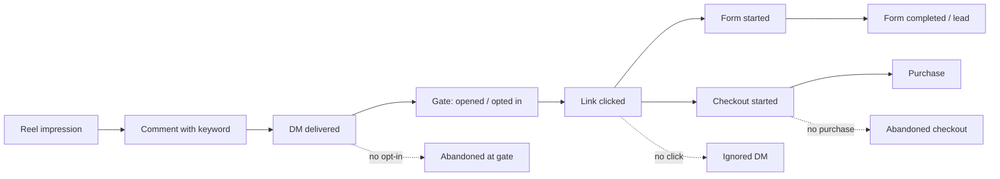

# Beyond Auto-DM — ROI Analytics Roadmap

> **Purpose:** Define the product moat that beats Zorcha and LinkPlease: provable ROI per post, keyword and follow-up — not vanity counters.
> **Audience:** Creators, D2C brands, agencies.
> **Status:** Phases A and B.1/B.3 are implemented (commits `ce09d88`, `58a8613`). Follow-up lift, intent clusters and Phase C/D remain planned.
> **Last updated:** 2026-11-26

---

## 1. The competitive thesis

Both competitors stop at *comments → DMs → link clicks*. That leaves three questions unanswered:

1. **Where exactly did the lead drop?** (gate, click, form, checkout)
2. **Which creative actually made money?** (not which got the most comments)
3. **Did the follow-ups earn their keep?** (or just annoy people)

dmplease should own **conversation-to-revenue attribution**. The differentiator is not "more charts" — it is that every metric has a next action: re-run, duplicate, message,

A useful positioning line:

> **"Stop counting clicks. Start knowing which Reel paid for itself."**

---

## 2. What dmplease already has (the foundation)

| Asset | Where | What it unlocks |
|---|---|---|
| Webhook lifecycle | `webhook_events` with status/duration/error | Trigger delivery rate, failure diagnostics |
| Comment records | `comment_events` (text, media_id, commenter) | Keyword/post attribution, viral-spike detection |
| Delivery records | `dm_logs` (status, keyword, recipient, timestamp) | DM delivery rate, 24h guard, retries |
| Opt-in/collection state | `pending_dms` (optin/collect/queued) | Follow-gate funnel, lead capture funnel |
| Contacts & conversations | `contacts`, `conversations`, `messages` | New vs returning, lead cohorts, intent |
| Click records | `link_clicks` (workspace, automation, contact, token, referrer) | CTR, time-to-click (needs `clicked_at` + post/keyword) |
| Daily rollups | `daily_creator_metrics`, Redis counters | Cheap aggregates at 25k creators |
| Meta Insights snapshots | `insight_snapshots` | Reel impressions → true reach-to-DM rate |
| Product analytics | PostHog + selective server events | Activation funnels, error tracking, replay |
| **UTM auto-tagging** | `linkForMessage()` in `lib/meta/webhook-processor.ts` | Already tags every DM link with `utm_source=dmplease`, `utm_medium=instagram_dm`, `utm_campaign=<automation-id>` |

**Important honesty constraint:** Instagram does **not** expose DM "opens" or "reads". We can measure *delivered*, *clicked* and *replied* — never "seen". Any "open rate" would be fabricated. Say so in the UI.

---

## 3. The four analytics layers

### Layer 1 — Full-funnel conversion & drop-off



| Metric | Definition | Data needed now |
|---|---|---|
| Trigger → delivery rate | `dm_logs SENT ÷ matching comment_events` | `post_id`, `keyword` on `dm_logs` |
| Delivery failure reasons | grouped count by status/error | already in `webhook_events`/`dm_logs` |
| Follow-gate conversion | `optin confirmations ÷ opening messages sent` | `pending_dms` events, `kind='optin'` |
| Gate abandonment | `1 − conversion`, with "resend without gate" action | UI action |
| DM CTR | `unique clickers ÷ delivered`, with bot filtering | `link_clicks.clicked_at`, `contact_id` |
| Time-to-click | buckets: ≤5m, ≤1h, ≤24h, >24h | `dm_logs.sent_at` → `link_clicks.clicked_at` |
| Form start → completion | started ÷ completed lead events | new `conversion_events` |
| Click → checkout | purchases ÷ clicks (server-verified) | `conversions` + UTM |

**Rule:** show denominators and reasons, never a bare percentage. A 1.8% CTR is useless; "2 of 110 clicked; 38 were still inside the follow-gate" is actionable.

### Layer 2 — Revenue, attribution & follow-up lift

| Metric | Definition |
|---|---|
| Revenue by post + keyword | `SUM(conversions.revenue_minor)` grouped by `post_id`, `keyword` |
| AOV, conversions, revenue per 100 DMs | derived from the same table |
| New vs returning buyer | first `conversion` per contact vs repeat |
| Follow-up lift | conversions tagged `sequence_step > 1`; compare to a holdout that got no follow-up |
| Follow-up annoyance cost | opt-outs / blocks / replies like "stop" per extra message |

Attribution order: **server webhook/payment callback > first-party pixel > UTM click > last click**. Never double-count — use `external_event_id` as an idempotency key.

### Layer 3 — Content, keyword & audience intelligence

- **Keyword leaderboard:** rank by revenue per 100 delivered DMs, not raw comment volume.
- **Post-type split:** Reel vs Story vs Carousel vs Live conversion efficiency.
- **Intent clusters:** group inbound replies into `pricing`, `shipping`, `how-it-works`, `collab`, `objection` using an LLM classifier with human override; surface weekly top questions.
- **High-intent drop-offs:** clicked link but did not convert → exportable segment + one-click recovery DM.
- **Negative signal detection:** repeated "stop"/"no" replies should pause follow-ups automatically.

### Layer 4 — Account health & diagnostics

- **Queue health:** queued vs sent vs delayed vs dead-letter during spikes; already partly in QStash DLQ + admin alerts.
- **Unanswered / window-expired:** comments where delivery failed or the 24h window closed — with one-click re-run.
- **Plain-English "Why it's low" insights:** e.g. *"Gate abandonment is 62%. Try a shorter opening message or turn off the gate for 7 days."*
- **Deliverability watch:** error 190, 429, persistent FAILED rows → proactive reconnect prompts.

---

## 4. Data model changes required

All changes are additive; no rewrite of the working pipeline.

### `dm_logs` — add attribution columns
```
post_id text, keyword text, sequence_step integer DEFAULT 1,
variant text, tracked_link_token text, clicked_at timestamptz
```

### `link_clicks` — add attribution columns
```
post_id text, keyword text, sequence_step integer, destination_host text,
clicked_at timestamptz DEFAULT now(), is_bot boolean DEFAULT false
```

### New `conversions` table
```
id uuid pk, workspace_id uuid, contact_id uuid,
automation_id uuid, post_id text, keyword text,
type text CHECK (type IN ('lead','checkout','purchase','subscribe')),
revenue_minor bigint DEFAULT 0, currency text DEFAULT 'INR',
external_event_id text, source text, occurred_at timestamptz,
metadata jsonb DEFAULT '{}'::jsonb,
UNIQUE (workspace_id, external_event_id)
```

### New `followup_steps` (or extend `automations`)
```
automation_id uuid, step integer, delay_minutes integer,
message text, enabled boolean, holdout_percent integer DEFAULT 0
```

### New `intent_clusters`
```
workspace_id uuid, contact_id uuid, message_id uuid,
label text, confidence numeric, created_at timestamptz
```

### Public conversion ingest
`POST /api/conversions/:workspaceToken` — signed, idempotent, rate-limited. Accepts `{event_type, email/igsid, revenue, currency, external_event_id, url}`. Resolves contact by IGSID/email → writes `conversions`. This is what makes external checkout trackable without asking creators to change platforms.

---

## 5. Product surfaces

### 5.1 "Wins & Fixes" card (highest visibility)
Top of `/dashboard/overview`, three tiles + one action each:

| Tile | Example | Action |
|---|---|---|
| Top performer | "GUIDE on Reel #14 — ₹18,400 / 90 days" | Duplicate flow |
| Biggest leak | "62% abandoned at follow-gate" | Test without gate |
| This week | "₹4,200 tracked · 31 leads · 9 purchases" | View attribution |

### 5.2 Funnel view per campaign
Step bars with counts, drop-off reasons, and a "re-run on recent comments" button on the delivery step.

### 5.3 Revenue by creative
Sortable table: post/keyword → DMs, CTR, leads, purchases, revenue, AOV.

### 5.4 Follow-up report
Initial vs Follow-up #1/#2 table with clicks, replies, purchases, and opt-out cost.

### 5.5 Diagnostics panel
Queue health, failed/window-expired opportunities, plain-English suggestions.

---

## 6. Packaging

| Plan | Included | Purpose |
|---|---|---|
| **Free** | Wins & Fixes (counts only), basic funnel, click CTR | Show value immediately |
| **Pro** | Full funnel, UTM auto-tagging, conversion webhook, revenue by post/keyword, follow-up report | The core paid moat |
| **Scale / Agency** | Cohorts, intent clusters, high-intent exports, shareable reports, API | Higher ACV, retention |

Do **not** gate the basic funnel — it is the proof that the product works. Gate attribution depth and automation actions.

---

## 7. Delivery phases

### Phase A — Instrument what already happens ✅ shipped
1. ✅ Attribution columns on `dm_logs` and `link_clicks`; populated from `sendCommentDm`, `sendOptinDm`, `processDirectRule` and `/go/[slug]`.
2. ✅ Wins & Fixes card and 6-step funnel v1 on `/dashboard/overview`.
3. ⬜ Queue/DLQ health and window-expired opportunities in admin diagnostics — already partly available in `/dashboard/admin/alerts` and the DLQ panel; a unified view remains for Phase A.3.
4. ✅ Verified: new DM logs carry `keyword`, `post_id`, `sequence_step`; existing logs backfilled; overview renders with no console errors.

### Phase B — Close the loop to revenue 🟠
1. ✅ `conversions` table + signed workspace token + public CORS-enabled ingest endpoint with UTM and last-click attribution.
2. ⬜ Stripe/Shopify/Razorpay webhook adapters — the generic endpoint already accepts their payloads if mapped; native adapters remain.
3. ✅ Revenue by post/keyword, tracked revenue and repeat-buyer count on Overview; AOV is derivable from the same rows.
4. ⬜ Follow-up step attribution with an optional holdout (`sequence_step` is already stored on conversions).
5. ✅ Verified: a test purchase was attributed to keyword `GUIDE`, post `17941881339122339` and the correct automation; duplicate replay returned `duplicate: true`; invalid token returned 401. Test row removed after verification.

### Phase C — Intelligence & action (6–8 weeks) 🟡
1. Intent clustering on inbound replies (LLM + human correction).
2. High-intent non-converter segment + recovery DM action.
3. Gated vs ungated A/B test with one-click rollout.
4. Shareable weekly report link.
5. **AC:** a creator can export "clicked but didn't buy" and send a recovery DM without leaving the dashboard.

### Phase D — Platform plays (later) 🟢
Native payment integrations, Meta CAPI conversion upload, flow builder, link-in-bio storefront, team roles, public API.

---

## 8. What not to build

- **Fake "open rates".** Instagram does not provide them.
- **Vanity leaderboards** sorted by raw comments or raw clicks.
- **Charts without a next action.** Every tile should lead somewhere.
- **A visual flow builder before attribution works.** A flow builder without ROI proof is a feature, not a moat.
- **Per-event writes to Postgres at scale.** Keep Redis counters + daily rollups; write conversion events only (low volume, high value).

---

## 9. Success metrics for this roadmap

| Signal | Target |
|---|---|
| % of delivered DMs with post + keyword attribution | > 95% |
| % of clicks linked to a contact | > 90% |
| Tracked conversion coverage (of creators who sell externally) | > 60% |
| Weekly Wins & Fixes engagement | > 40% of active creators |
| Revenue-attributed retention lift | measurable cohort difference after 30 days |

---

## 10. Next step

Revenue attribution is shipped. The next highest-leverage step is **Phase C** — intent clusters on inbound replies plus a "clicked but didn't buy" recovery action. That turns analytics into a revenue action rather than a report.
